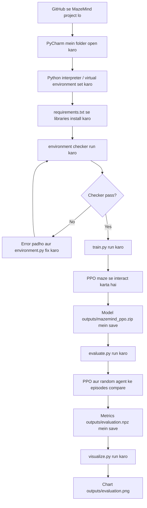

# MazeMind 🧩 — Beginner's Complete Guide

MazeMind ek chhota **Reinforcement Learning (RL)** project hai. Hum ek virtual agent ko fixed 5×5 maze mein start se goal tak pahunchna sikhane ki koshish karte hain. Iske liye hum Stable-Baselines3 ki PPO algorithm use karte hain, phir uske results ko random moves lene wale agent se compare karte hain.

**Agar tumhe project ke baare mein zero knowledge hai, to code se start mat karo.** Neeche diye order mein docs padho.

## Sabse pehle: project ka simple idea

Socho ek game hai. Agent maze mein khada hai. Har turn par wo up, right, down ya left move choose karta hai. Sahi jagah pahunchne par reward milta hai; har normal step par chhota penalty hota hai. RL algorithm repeated attempts se aisi policy learn karne ki koshish karta hai jo zyada reward de.

Is project ka purpose production app banana nahi, balki ML experiment ka complete lifecycle samajhna hai: environment banana → agent train karna → performance measure karna → chart banana.

## End-to-end flowchart



## Files ka map

| File/folder | Iska kaam |
|---|---|
| `environment.py` | Maze, movement rules, agent ko dikhne wali information aur rewards define karta hai. |
| `train.py` | Environment check karta hai, PPO train karta hai aur model save karta hai. |
| `evaluate.py` | Trained PPO ko random-action baseline se compare karta hai. |
| `visualize.py` | Evaluation ke saved numbers ko charts mein dikhata hai. |
| `requirements.txt` | Required Python libraries ke names/versions. |
| `outputs/` | Run karne ke baad generate hone wali model, logs, results aur image. |
| `docs/` | Learning notes, code explanations, flowcharts, math, references aur troubleshooting. |

## PyCharm mein run karne ka short version

Project folder open karo, Python interpreter select karo, Terminal open karo aur project root par ye commands ek-ek karke chalao:

```powershell
python -m pip install -r requirements.txt
python -c "from stable_baselines3.common.env_checker import check_env; from environment import MazeEnv; check_env(MazeEnv()); print('Environment OK')"
python train.py
python evaluate.py
python visualize.py
```

Har command ka explanation aur expected files [Installation and Running](docs/02-installation.md) aur [Training and Troubleshooting](docs/06-training-and-evaluation.md) mein hai. Training command complete hone se pehle agla step mat chalao.

## Docs padhne ka exact order

1. [00 — Start here: project, purpose, flowchart, workflow](docs/00-project-flow.md)
2. [01 — Prerequisites: kya seekhna zaroori hai](docs/01-prerequisites.md)
3. [02 — PyCharm setup and installation: commands ka meaning](docs/02-installation.md)
4. [03 — Python, NumPy and maths basics](docs/03-python-basics.md)
5. [04 — Maze environment: code kaise world banata hai](docs/04-maze-environment.md)
6. [05 — RL, rewards, PPO and maths](docs/05-reinforcement-learning.md)
7. [06 — Training, evaluation, output and errors](docs/06-training-and-evaluation.md)
8. [07 — Official sources, videos and help kaise leni hai](docs/07-resources.md)
9. [08 — All main files ka connected code walkthrough](docs/08-code-walkthrough.md)
10. [09 — Project ko kisi aur ko kaise explain karein](docs/09-how-to-explain-project.md)

## Project ki boundaries

Ye version intentionally simple hai: one fixed maze, one PPO agent, one random baseline, two charts. Ismein web app, database, paid API, cloud deployment, multiple algorithms ya maze generator nahi hai. GPU required nahi hai.

PPO ko hum khud scratch se implement nahi kar rahe. Stable-Baselines3 algorithm provide karta hai; hum environment aur experiment setup kar rahe hain. Model save ho jaana success ka proof nahi—evaluation ke actual results dekhne hain.

## Official starting references

- [Python tutorial](https://docs.python.org/3/tutorial/)
- [NumPy quickstart](https://numpy.org/doc/stable/user/quickstart.html)
- [Gymnasium custom environment tutorial](https://gymnasium.farama.org/tutorials/gymnasium_basics/environment_creation/)
- [Stable-Baselines3 PPO](https://stable-baselines3.readthedocs.io/en/master/modules/ppo.html)
- [Matplotlib quick start](https://matplotlib.org/stable/users/explain/quick_start.html)
