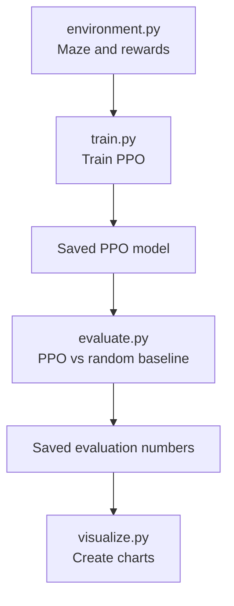

# MazeMind 🧩

A beginner-friendly Reinforcement Learning project: train a PPO agent to navigate one fixed 5×5 maze, then compare it with random actions.

**Project goal:** understand the full ML experiment workflow—not build a production robot or a complicated application.

## Start here

**New to the project? Read [the complete project flow](docs/00-project-flow.md) first.** It explains the architecture, flowcharts, maze layout, files, commands, and expected outputs.

## What happens in this project?



- **Gymnasium:** defines the maze environment and action/observation interface.
- **Stable-Baselines3 PPO:** trains the agent.
- **NumPy:** represents the grid and calculates metrics.
- **Matplotlib:** plots the evaluation results.

The project uses no paid APIs, pretrained models, or GPU. Training runs locally. Results vary; training is not guaranteed to solve the maze.

## Project structure

```text
MazeMind/
├── README.md
├── requirements.txt
├── environment.py        # maze, actions, observations and rewards
├── train.py              # environment check, PPO training and model save
├── evaluate.py           # evaluate PPO and random baseline
├── visualize.py          # plots evaluation metrics
├── outputs/              # generated model, logs, data and chart
└── docs/
    ├── 00-project-flow.md
    ├── 01-prerequisites.md
    ├── 02-installation.md
    ├── 03-python-basics.md
    ├── 04-maze-environment.md
    ├── 05-reinforcement-learning.md
    ├── 06-training-and-evaluation.md
    ├── 07-resources.md
    └── 08-code-walkthrough.md
```

## Setup in PyCharm (Windows)

1. Open the cloned `MazeMind` folder in PyCharm.
2. Select a Python interpreter supported by the installed Stable-Baselines3/PyTorch versions. Python 3.11 is a sensible starting choice.
3. Open the PyCharm Terminal at the project root.
4. Create and activate a virtual environment if needed:

```powershell
python -m venv .venv
.venv\Scripts\Activate.ps1
python -m pip install --upgrade pip
python -m pip install -r requirements.txt
```

If PowerShell blocks activation, use PyCharm's selected project interpreter or Command Prompt activation from [installation guide](docs/02-installation.md).

## Run in this order

```bash
# 1. Check the environment API
python -c "from stable_baselines3.common.env_checker import check_env; from environment import MazeEnv; check_env(MazeEnv()); print('Environment OK')"

# 2. Train and save PPO
python train.py

# 3. Compare PPO with random actions
python evaluate.py

# 4. Create charts
python visualize.py
```

Expected output files:
- `outputs/mazemind_ppo.zip`
- `outputs/training_monitor.csv`
- `outputs/evaluation.npz`
- `outputs/evaluation.png`

These are expected paths. The actual training logs and performance metrics vary by run. **A saved model file alone does not prove that the agent learned.**

## Learn in order

1. [00 — Complete project flow and flowcharts](docs/00-project-flow.md)
2. [01 — Prerequisites](docs/01-prerequisites.md)
3. [02 — Installation](docs/02-installation.md)
4. [03 — Python and NumPy basics](docs/03-python-basics.md)
5. [04 — Maze environment](docs/04-maze-environment.md)
6. [05 — Reinforcement Learning and PPO](docs/05-reinforcement-learning.md)
7. [06 — Training, evaluation and plots](docs/06-training-and-evaluation.md)
8. [07 — References and videos](docs/07-resources.md)
9. [08 — Code walkthrough, block by block](docs/08-code-walkthrough.md)

## Keep the scope small

One fixed maze, one PPO model, one random baseline, and two charts. No web app, database, cloud deployment, or extra algorithms. Understand and run this version before adding features.

## Limitations

- Generalization to unseen mazes is not tested.
- The random baseline may occasionally reach the goal.
- Results must be reported from actual runs, not guessed.
- This is an educational prototype, not a robotics or RL benchmark.

## License

Choose a license before accepting outside contributions or reuse.
