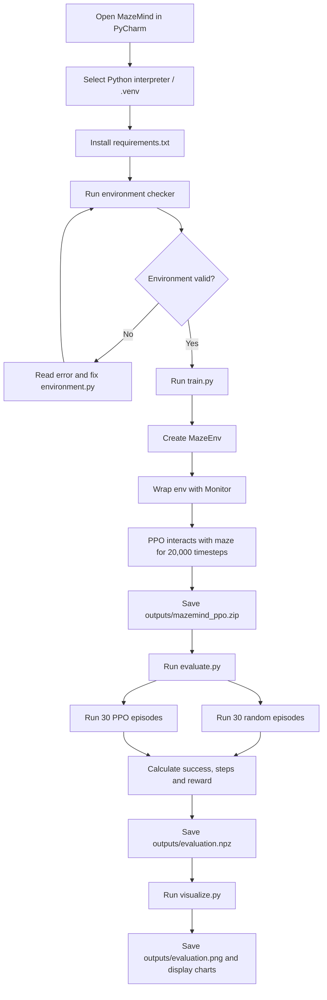

# MazeMind — Project Flow, from Zero to Result

This guide explains the whole project before you read individual Python files. Read it first.

## 1. What are we building?

MazeMind is a small Reinforcement Learning (RL) experiment. A virtual agent starts at the top-left of a fixed 5×5 maze and tries to reach the goal at the bottom-right. We use PPO from Stable-Baselines3 to train the agent, then compare it with an agent that chooses moves randomly.

**What success means:** after training, measure how often PPO reaches the goal and how many steps it takes. Do not assume it works just because a model file was saved.

## 2. The complete workflow



If the checker fails, do not start training yet. If evaluation says the model is missing, run training first. If visualization says evaluation data is missing, run evaluation first.

## 3. How the agent interacts with the maze

```mermaid
flowchart TD
    A[reset: place agent at start] --> B[Encode maze as 75 numbers]
    B --> C[PPO policy selects action]
    C --> D[step(action)]
    D --> E[Check bounds and wall]
    E --> F[Move if cell is valid; otherwise stay]
    F --> G[Give reward: usually -0.01, goal +1.0]
    G --> H{Goal reached or 50 steps used?}
    H -- No --> B
    H -- Goal --> I[Episode successful]
    H -- 50 steps --> J[Episode ended by limit]
```

An **episode** is one attempt. A normal move costs -0.01; reaching the goal gives +1.0. An invalid move (wall or outside the grid) does not move the agent, but still consumes a step and gets the normal step penalty.

## 4. Files: what each one does

| File | Responsibility | What it does not do |
|---|---|---|
| `requirements.txt` | Lists Python libraries to install | Does not run the project |
| `environment.py` | Defines maze, legal movement rules, observation and rewards | Does not train a model |
| `train.py` | Checks environment, trains PPO, saves model | Does not compare final performance |
| `evaluate.py` | Compares saved PPO model with random actions | Does not train the model |
| `visualize.py` | Reads evaluation data and creates charts | Does not train or evaluate |
| `outputs/` | Stores model, logs, result data and plot | Created by scripts when needed |
| `docs/` | Learning guides and references | Not required to execute Python |

## 5. Maze representation

The grid is a NumPy array with 5 rows and 5 columns. In `environment.py`, `1` means wall and `0` means a walkable cell. Coordinates are `(row, column)`, starting from zero.

```text
A . # . .
# . # . #
. . . . .
. # # # .
# . . . G
```

- `A` = agent start position (row 0, column 0)
- `G` = goal (row 4, column 4)
- `#` = wall
- `.` = free cell

This drawing shows the fixed layout. The agent's displayed position changes while an episode runs.

## 6. What does the agent see?

The environment combines three 5×5 arrays:
1. Wall layer: where walls are.
2. Goal layer: a 1 at the goal cell.
3. Agent layer: a 1 at the current agent cell.

Stacked shape: `(3, 5, 5)`. Flattened observation shape: `(75,)`, which means 75 numbers in one vector. The PPO `MlpPolicy` accepts this flat vector.

## 7. Run commands in this exact order

Run each command from the MazeMind project root in PyCharm Terminal, with the project's virtual environment selected/activated.

1. Install packages: `python -m pip install -r requirements.txt`
2. Validate: `python -c "from stable_baselines3.common.env_checker import check_env; from environment import MazeEnv; check_env(MazeEnv()); print('Environment OK')"`
3. Train: `python train.py`
4. Evaluate: `python evaluate.py`
5. Plot: `python visualize.py`

Expected artifacts:
- `outputs/mazemind_ppo.zip` — trained PPO model
- `outputs/training_monitor.csv` — training episode log
- `outputs/evaluation.npz` — numeric evaluation results
- `outputs/evaluation.png` — comparison chart

The exact terminal logs and metrics depend on your run. The values are not pre-guaranteed.

## 8. A beginner-friendly way to study the code

1. Read this flow guide once.
2. Read `environment.py` first: understand the world before the learning algorithm.
3. Run the environment checker.
4. Read `train.py` and learn what PPO settings mean; you do not need to reimplement PPO.
5. Run training.
6. Read `evaluate.py` and learn how the success rate is measured.
7. Read `visualize.py` and connect the chart to the saved numbers.
8. Use [08-code-walkthrough.md](08-code-walkthrough.md) when you need each important code block explained.

## References

- [Gymnasium: Create a custom environment](https://gymnasium.farama.org/tutorials/gymnasium_basics/environment_creation/)
- [Gymnasium Env API](https://gymnasium.farama.org/api/env/)
- [Stable-Baselines3 PPO](https://stable-baselines3.readthedocs.io/en/master/modules/ppo.html)
- [SB3 custom environments and checker](https://stable-baselines3.readthedocs.io/en/master/guide/custom_env.html)
- [Matplotlib quick start](https://matplotlib.org/stable/users/explain/quick_start.html)

Video searches: [RL agent/environment/reward](https://www.youtube.com/results?search_query=reinforcement+learning+agent+environment+reward+beginner), [PPO explained](https://www.youtube.com/results?search_query=PPO+reinforcement+learning+explained+beginner), [Gymnasium custom environment](https://www.youtube.com/results?search_query=Gymnasium+custom+environment+Stable+Baselines3).
