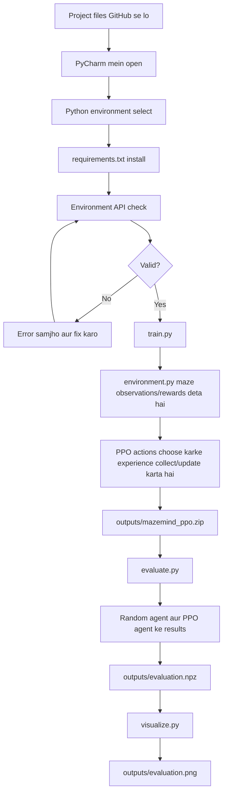
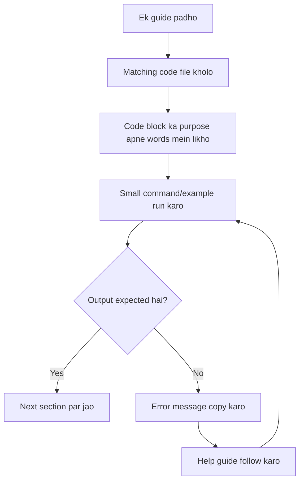

# 00 — Start Here: MazeMind ko zero se samjho

**Is guide ko pehle padho.** Agar tumhe RL, PPO ya maze environment ka knowledge nahi hai, koi problem nahi. Is page ka goal hai pehle poori picture samjhana; technical details baad ke docs mein hain.

## 1. Hum bana kya rahe hain?

MazeMind ek learning experiment hai. Ek virtual agent 5 rows aur 5 columns wale maze mein start cell se goal tak pahunchne ki koshish karta hai. Har turn mein agent ek action choose karta hai: up, right, down ya left. Hum PPO naam ka Reinforcement Learning algorithm use karte hain taaki agent better actions choose karna seekhne ki koshish kare.

**Project ka goal:** RL ka complete workflow samajhna—not ek perfect AI ya production product banana.

## 2. Maze ko dekho

```text
A . # . .
# . # . #
. . . . .
. # # # .
# . . . G
```

- `A`: agent ka start cell, coordinate `(0, 0)`.
- `G`: goal cell, coordinate `(4, 4)`.
- `#`: wall; agent ismein enter nahi kar sakta.
- `.`: free cell.
- Coordinates `(row, column)` hain. Python mein counting zero se start hoti hai.

Ye diagram maze ka layout samjhata hai. `environment.py` ke andar actual numeric array hai; agent isi environment ke rules ke through move karta hai.

## 3. RL ke important words

| Word | Simple meaning | MazeMind example |
|---|---|---|
| Agent | Jo decision leta hai | PPO policy |
| Environment | Jahan agent act karta hai | 5×5 maze |
| State/observation | Agent ko di gayi current information | Walls, goal aur current position ki 75 numbers wali representation |
| Action | Agent ka selected move | Up/right/down/left |
| Reward | Action ke baad milne wala score/feedback | Normal step par -0.01; goal par +1 |
| Episode | Start se finish/limit tak ek attempt | Ek maze-solving try |
| Policy | Observation se action choose karne ka learned rule | PPO ka decision function |
| Training | Policy ko experience se update karna | 20,000 environment timesteps |
| Evaluation | Check karna ki policy kitni achhi perform karti hai | 30 PPO episodes vs 30 random episodes |

## 4. Complete project flowchart



## 5. Har Python file kyun hai?

### `environment.py` — duniya ke rules
Is file mein maze layout, start/goal, actions, observations, rewards aur episode-ending conditions hain. Ye file decide karti hai ki action valid hai ya nahi, agent move karega ya nahi, aur next observation kya hoga.

### `train.py` — learning process
Ye environment checker run karta hai, maze ko Monitor wrapper mein rakhta hai, PPO model banata hai, training chalata hai aur model save karta hai.

### `evaluate.py` — fair comparison
Ye saved model load karta hai aur do methods test karta hai: random moves aur PPO ke predicted moves. Phir success rate, average steps aur average reward print karta hai.

### `visualize.py` — numbers ko picture banana
Ye `evaluation.npz` read karta hai, do bar charts banata hai aur `evaluation.png` save karta hai.

### `requirements.txt` — libraries ki list
Ye Python package installer ko batata hai ki kaunse third-party packages install karne hain. Ye khud code execute nahi karta.

## 6. Run order kyun important hai?

1. **Install**: Python libraries available honi chahiye.
2. **Check environment**: training se pehle verify karo ki Gymnasium API correct hai.
3. **Train**: saved model generate hota hai.
4. **Evaluate**: model file aur environment dono chahiye; numeric results save hote hain.
5. **Visualize**: evaluation data file chahiye.

Agar tum `evaluate.py` pehle run karoge to model file missing ho sakti hai. Agar `visualize.py` pehle run karoge to evaluation data missing ho sakta hai.

## 7. Expected output files

| Path | Kab banta hai | Meaning |
|---|---|---|
| `outputs/mazemind_ppo.zip` | Training ke baad | Saved PPO policy |
| `outputs/training_monitor.csv` | Training ke dauran | Episode statistics/log |
| `outputs/evaluation.npz` | Evaluation ke baad | Random aur PPO ke per-episode numbers |
| `outputs/evaluation.png` | Visualization ke baad | Comparison chart |

Exact success rate pehle se known nahi hai. Jo terminal output tumhare run mein aayega wahi actual result hai.

## 8. Project mein kaunsi maths hai?

- **Grid coordinates:** row/column indexing.
- **Arrays and shapes:** 3 × 5 × 5 = 75 observation values.
- **Rewards:** har step ka numeric feedback.
- **Average/mean:** episodes ke results ka average.
- **Success rate:** successful episodes / total episodes.
- **Discounted return:** future rewards ko discount karke total score; PPO jaise algorithms mein useful.
- **PPO optimization:** policy update karne ki math library handle karti hai. Is beginner project mein PPO ka optimizer scratch se implement nahi karna.

Maths detail [RL and PPO](05-reinforcement-learning.md) aur [Python/NumPy basics](03-python-basics.md) mein hai.

## 9. Tumhe kaam kaise karna hai?



Pehle poora code memorize karne ki zaroorat nahi. Samjho: input kya hai, code kya karta hai, output kya aata hai aur ye step next file ke liye kyun needed hai.

## 10. Next kya padho?

[01 — Prerequisites](01-prerequisites.md) par jao. Uske baad har guide ek hi order mein follow karo. Code walkthrough tab use karo jab Python file dekhte waqt confusion aaye.

Official references: [Gymnasium environment tutorial](https://gymnasium.farama.org/tutorials/gymnasium_basics/environment_creation/), [Stable-Baselines3 PPO](https://stable-baselines3.readthedocs.io/en/master/modules/ppo.html).
