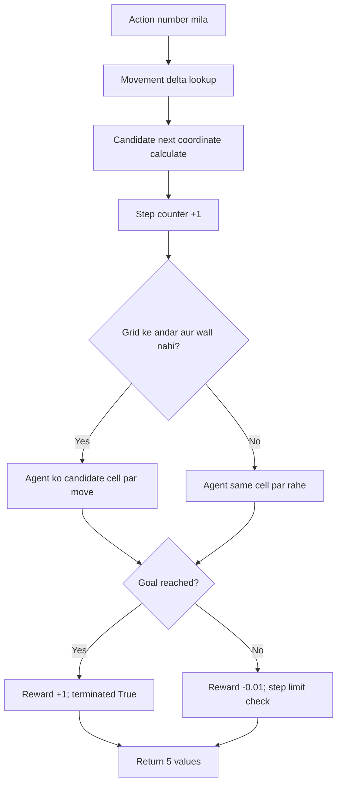

# 04 — environment.py: Maze ke rules aur code ka logic

Is file ko training se pehle samajhna sabse useful hai. Agent isi environment se interact karta hai. Agar environment galat ho, algorithm achha hone par bhi useful result nahi milega.

## 1. Environment kya hai?

Game ke rules aur game world ko environment samjho. MazeMind mein environment define karta hai:
- maze mein walls kahan hain;
- agent kahan se start karta hai;
- goal kahan hai;
- kaunse actions available hain;
- action ke baad agent kahan jayega;
- reward kya hoga;
- episode kab khatam hoga.

## 2. Maze layout

```text
A . # . .
# . # . #
. . . . .
. # # # .
# . . . G
```

`environment.py` mein `self.walls` NumPy array hai. 1 wall aur 0 walkable cell. Start `(0,0)`; goal `(4,4)`. Coordinates `(row,column)` hain.

## 3. Imports and class

```python
import gymnasium as gym
import numpy as np
from gymnasium import spaces

class MazeEnv(gym.Env):
    def __init__(self, max_steps=50):
        super().__init__()
        self.rows = 5
        self.cols = 5
        self.max_steps = max_steps
```

- Gymnasium ek standard RL environment interface deta hai.
- NumPy maze ko numeric form mein store karta hai.
- `spaces` action aur observation ke valid formats define karta hai.
- `MazeEnv(gym.Env)` Gymnasium environment ko extend karta hai.
- `__init__` object ki initial state set karta hai.
- `max_steps=50` har episode ki action limit hai.

## 4. Action space

```python
self.action_space = spaces.Discrete(4)
self.moves = {
    0: (-1, 0),
    1: (0, 1),
    2: (1, 0),
    3: (0, -1),
}
```

`Discrete(4)` means 4 possible integer actions. Movement delta `(row_change, column_change)` hota hai:

| Action | Delta | Move |
|---:|---|---|
| 0 | (-1, 0) | Up |
| 1 | (0, +1) | Right |
| 2 | (+1, 0) | Down |
| 3 | (0, -1) | Left |

Example: agent `(2, 1)` par hai aur action 1 choose karta hai. New candidate coordinate `(2, 2)` hoga.

## 5. Observation space — agent ko kya dikhai deta hai?

```python
self.observation_space = spaces.Box(
    low=0.0,
    high=1.0,
    shape=(3 * self.rows * self.cols,),
    dtype=np.float32,
)
```

Agent ko plain text `A . #` directly nahi diya jaata. Usko numeric vector diya jaata hai. Teen layers use hoti hain: wall map, goal position aur agent position. Har layer mein 25 values; total 75.

```python
def _get_obs(self):
    agent_layer = np.zeros_like(self.walls)
    agent_layer[self.agent] = 1.0
    stacked = np.stack([self.walls, self.goal_layer, agent_layer])
    return stacked.flatten().astype(np.float32)
```

Line-by-line:
1. `zeros_like(self.walls)`: walls jaisa 5×5 zero array banata hai.
2. `agent_layer[self.agent] = 1.0`: current agent cell ko 1 mark karta hai.
3. `np.stack(...)`: teen layers ko combine karta hai.
4. `flatten()`: shape `(3,5,5)` ko `(75,)` banata hai.
5. `astype(np.float32)`: expected numeric type ensure karta hai.

## 6. reset(): episode start karna

```python
def reset(self, seed=None, options=None):
    super().reset(seed=seed)
    self.agent = self.start
    self.steps = 0
    return self._get_obs(), {}
```

Har new episode par agent start cell par lauta diya jaata hai aur step counter zero hota hai. Function observation aur empty info dictionary return karta hai. Gymnasium ke interface mein return `(observation, info)` hota hai.

## 7. step(action): ek move apply karna

Is function ko conceptually is order mein samjho:



Code ka main logic:
- `self.moves[int(action)]` action ko movement mein convert karta hai.
- `next_row` aur `next_col` candidate cell hain.
- `inside_grid` check karta hai ki row/column range 0–4 mein hai.
- Candidate cell wall nahi hai tabhi agent move karta hai.
- Normal step ka reward `-0.01`; goal reach karne par `+1.0`.
- `terminated` True tab hota hai jab task goal reach karke complete ho.
- `truncated` True tab hota hai jab 50-step limit aa jaaye aur goal na mila ho.

**Important:** wall mein takrana ya maze se bahar move karne ki koshish agent ko wahi rakhti hai, lekin step count badhta hai. Isliye invalid move bhi episode budget use karta hai.

Gymnasium API ka return:

```python
observation, reward, terminated, truncated, info
```

## 8. render(): humans ke liye text view

```python
env = MazeEnv()
print(env.render())
```

Ye maze ko text mein show karta hai. A = agent, G = goal, # = wall, . = free cell. Ye debugging/understanding ke liye hai; PPO numeric observation use karta hai.

## 9. Try it in PyCharm

Project root mein temporary Python Console ya small scratch script mein:

```python
from environment import MazeEnv

env = MazeEnv()
observation, info = env.reset(seed=42)
print(observation.shape)
print(env.render())
```

Expected first line:

```text
(75,)
```

Maze display agent ke current start position ko `A` se show karega. Agar import fail ho, check karo file ka naam `environment.py` hai aur terminal project root mein hai.

## 10. Environment checker

```python
from stable_baselines3.common.env_checker import check_env
from environment import MazeEnv

check_env(MazeEnv())
print("Environment OK")
```

Checker common API issues catch karta hai—jaise observation shape/type mismatch. Ye guarantee nahi karta ki agent maze solve karega; sirf environment interface check karta hai.

## Official references and videos

- [Gymnasium environment creation](https://gymnasium.farama.org/tutorials/gymnasium_basics/environment_creation/)
- [Gymnasium Env API](https://gymnasium.farama.org/api/env/)
- [Gymnasium spaces](https://gymnasium.farama.org/api/spaces/)
- [SB3 custom environments](https://stable-baselines3.readthedocs.io/en/master/guide/custom_env.html)
- [Video: custom Gymnasium environment](https://www.youtube.com/results?search_query=Gymnasium+custom+environment+tutorial+beginner)

## Self-check

1. Why does the environment need both action_space and observation_space?
2. Why does an invalid move still increase steps?
3. What is the difference between terminated and truncated?
4. Why is the observation 75 values rather than just the agent coordinate?
