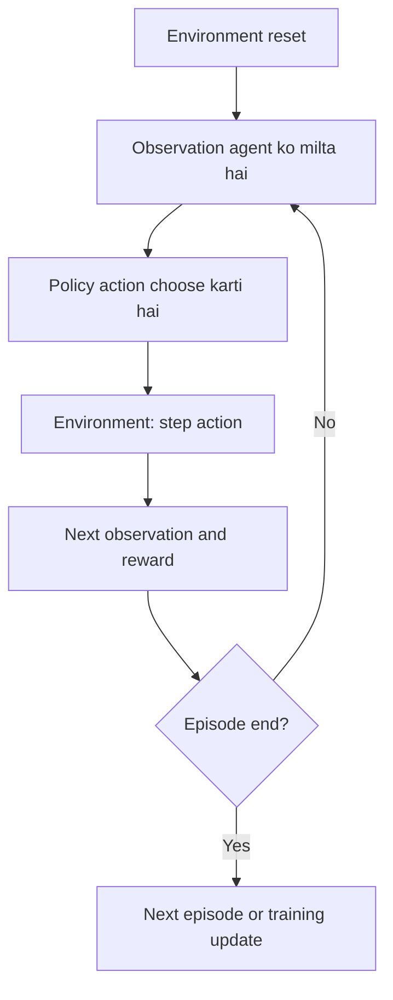

# 05 — Reinforcement Learning, Rewards, PPO aur Maths

Ye guide project ki ML theory explain karti hai. Goal hai concepts ko explain kar paana—not PPO ko scratch se code karna.

## 1. Supervised learning vs Reinforcement Learning

Supervised learning mein training examples ke saath known target/answer hota hai, jaise image aur uska label. Reinforcement Learning mein agent environment ke saath interact karta hai. Usko har step par reward milta hai aur wo long-term reward improve karne ki koshish karta hai.

MazeMind mein:
- Agent: PPO policy.
- Environment: `MazeEnv`.
- Observation: maze/goal/agent ki 75-number representation.
- Action: up, right, down, left.
- Reward: ordinary step par -0.01; goal par +1.
- Episode: ek complete attempt.
- Policy: observation se action choose karne ka rule.

## 2. Interaction loop



Agent ek move choose karta hai; environment us move ke result ko calculate karta hai. PPO training ke dauran collected experience use karke policy parameters update karta hai.

## 3. Reward design

Code mein ordinary step reward `-0.01` hai aur goal par `+1.0`.

Why?
- Har move ka small penalty unnecessary wandering ko discourage karta hai.
- Goal reward task completion ko positive feedback deta hai.
- Reward design learning ko affect karta hai; values ko experiment kiye bina optimal assume nahi karna.

Agar agent wall mein takrata hai, wo move nahi karta, lekin time/step consume hota hai aur normal penalty milti hai.

## 4. Reward sum and return

Ek episode ke rewards ka simple total:

```text
total reward = r1 + r2 + r3 + ... + rT
```

Agar episode mein 3 ordinary steps aur phir goal reach ho:

```text
-0.01 + -0.01 + -0.01 + 1.0 = 0.97
```

Ye example hai, actual run ka result nahi. Ismein 3 normal steps ke baad goal-reach step ko +1 maana hai.

RL mein future reward ko discount karne ke liye discounted return bhi use hota hai:

```text
G_t = r_t + gamma*r_(t+1) + gamma^2*r_(t+2) + ...
```

- `G_t`: current time se aage ka discounted reward.
- `r_t`: current reward.
- `gamma`: discount factor; is project mein `0.99`.
- Gamma 1 ke close hai, isliye future reward bhi important rehta hai, par thoda discount hota hai.

Tumhe ye return manually calculate karke code mein implement nahi karna; Stable-Baselines3 PPO training ke andar required calculations handle karta hai.

## 5. PPO kya hai?

PPO = **Proximal Policy Optimization**. Ye policy-gradient family ka reinforcement learning algorithm hai. Stable-Baselines3 PPO ki tested implementation provide karta hai. MazeMind mein hum algorithm ke andar ke optimizer ko khud implement nahi karte.

High-level PPO idea:
1. Current policy se environment mein actions lo.
2. Observations, actions, rewards aur episode outcomes collect karo.
3. Collected experience se estimate karo ki actions expected reward ko improve karte hain ya nahi.
4. Policy ko update karo, lekin updates ko excessively large hone se rokne ki koshish karo.
5. Process ko training budget tak repeat karo.

PPO ka clipped objective old policy se bahut bade policy updates ko limit karne mein help karta hai. Exact derivation advanced hai; beginner project ke liye conceptual understanding enough hai.

## 6. Policy and MlpPolicy

```python
model = PPO("MlpPolicy", env, ...)
```

- `PPO`: algorithm.
- `"MlpPolicy"`: flat numeric observation ko process karne ke liye multilayer perceptron/fully connected neural network policy.
- `env`: Gymnasium maze environment.

Yahan input vector 75 numbers ka hai. Network action choices ke liye policy learn karta hai. Is project mein hum neural network layers ko manually code nahi karte.

## 7. Training parameters: kya mean karte hain?

| Parameter | Current value | Simple meaning |
|---|---:|---|
| `learning_rate` | 0.0003 | Optimizer update ka scale |
| `n_steps` | 256 | PPO update se pehle environment se collect hone wale steps per environment |
| `batch_size` | 64 | Training minibatch mein samples |
| `gamma` | 0.99 | Future reward discount factor |
| `total_timesteps` | 20,000 | Training interaction budget |
| `seed` | 42 | Randomness ko control/reproduce karne mein help |
| `verbose` | 1 | Training logs display karna |

Ye educational starting values hain, guaranteed optimal settings nahi. `seed=42` se run repeat karne mein help milti hai, lekin every machine/environment par exact identical result guaranteed nahi.

## 8. Random baseline kyun?

Agar PPO result ko context ke bina dekho, pata nahi chalega ki agent learned hai ya random actions bhi similar result de sakte hain. Isliye evaluation:
- 30 episodes random actions ke saath;
- 30 episodes trained PPO policy ke saath.

Agar PPO random baseline se better nahi, to honest conclusion ye hoga ki is run mein learning demonstrate nahi hui. Maze, reward, observation, training budget aur random variability investigate karo. Sirf model file save hone ko success mat bolo.

## 9. Evaluation metrics ki maths

**Success rate**

```text
success rate = successful episodes / total episodes
```

30 episodes mein 18 successes:

```text
18 / 30 = 0.60 = 60%
```

**Mean steps:** sab episodes ke step counts ka sum divided by number of episodes. Success rate ke saath interpret karo; jaldi fail hona bhi low step count de sakta hai.

**Mean reward:** har episode ke reward total ka average. Reward design ke context mein read karo; isko alone success ka proof mat samjho.

## 10. Limitations

- Maze layout fixed hai; unseen mazes par generalization test nahi hoti.
- Random baseline kabhi-kabhi goal tak pahunch sakta hai.
- 20,000 timesteps se solve hona guaranteed nahi.
- Ek run se strong scientific conclusion nahi nikalta.
- PPO ki complete math/code library ke andar hai; project ka focus environment aur experiment workflow hai.

## Official references

- [Stable-Baselines3 PPO API](https://stable-baselines3.readthedocs.io/en/master/modules/ppo.html)
- [SB3 quickstart](https://stable-baselines3.readthedocs.io/en/master/guide/quickstart.html)
- [OpenAI Spinning Up: PPO](https://spinningup.openai.com/en/latest/algorithms/ppo.html)
- [Hugging Face Deep RL course](https://huggingface.co/learn/deep-rl-course/unit0/introduction)

Videos:
- [Reinforcement Learning basics](https://www.youtube.com/results?search_query=reinforcement+learning+agent+environment+reward+beginner)
- [PPO explained for beginners](https://www.youtube.com/results?search_query=PPO+reinforcement+learning+explained+beginner)
- [Stable-Baselines3 PPO tutorial](https://www.youtube.com/results?search_query=Stable+Baselines3+PPO+Gymnasium+tutorial)

## Self-check

1. RL aur supervised learning ka key difference?
2. Step penalty -0.01 kyun rakha?
3. Gamma 0.99 ka broad meaning?
4. PPO library use karne aur PPO scratch se implement karne mein difference?
5. Random baseline comparison kya prove karne mein help karta hai?
