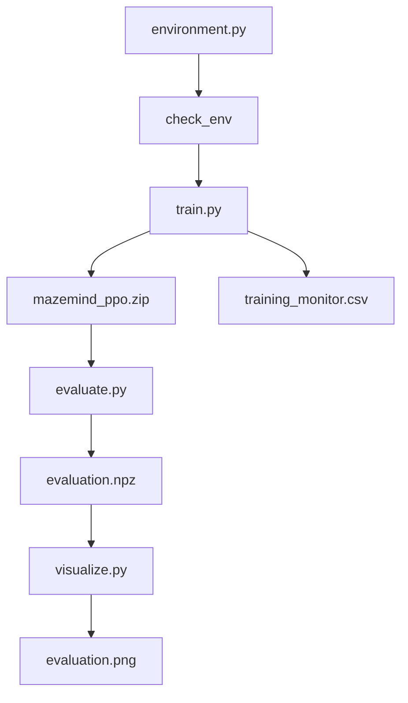

# 06 — Training, Evaluation, Output Files aur Troubleshooting

Is page ko practical run guide ki tarah use karo. Commands PyCharm Terminal mein **MazeMind project root** se run karo.

## Before you start

- `requirements.txt` install ho chuki ho.
- `environment.py` present ho.
- Environment checker successful ho.
- Correct PyCharm interpreter/virtual environment selected ho.

## Step 1 — Environment validate karo

```bash
python -c "from stable_baselines3.common.env_checker import check_env; from environment import MazeEnv; check_env(MazeEnv()); print('Environment OK')"
```

Expected final message: `Environment OK`.

Ye checker interface problems pakadta hai. Ye agent ko train nahi karta aur maze solve hone ki guarantee nahi deta.

## Step 2 — PPO train karo

```bash
python train.py
```

Code ke andar high-level steps:
1. `outputs/` folder create karna.
2. `check_env(MazeEnv())` se environment check.
3. `Monitor` wrapper ke saath environment create karna.
4. PPO model aur settings initialize karna.
5. `model.learn(total_timesteps=20_000)` se training.
6. `model.save(...)` se model file save karna.

Expected final message:

```text
Saved model to: outputs/mazemind_ppo.zip
```

Training logs aur time computer/packages ke hisaab se vary karte hain. Command complete hone do. Agar traceback/error aaye, pehle usko fix karo.

### Training output ka meaning

- `mazemind_ppo.zip`: saved model/policy parameters aur required model data.
- `training_monitor.csv`: Monitor wrapper ke episode-level statistics.
- Terminal logs: training ke dauran algorithm ke diagnostic values.

Model save hone ka matlab training procedure run hua; ye guarantee nahi ki agent goal tak pahunchna seekh gaya.

## Step 3 — Evaluate karo

```bash
python evaluate.py
```

Script saved PPO model load karti hai. Phir 30 random episodes aur 30 PPO episodes run karti hai.

Output ka format:

```text
Random baseline: success=..., mean steps=..., mean reward=...
PPO agent: success=..., mean steps=..., mean reward=...
Saved evaluation results to: outputs/evaluation.npz
```

Ellipses illustrative placeholders hain, real results nahi. Apne run ke exact metrics record karna.

### Metrics ka meaning

- **Success:** episode goal par end hua.
- **Success rate:** successful episodes / total episodes. 15/30 = 50%.
- **Mean steps:** average steps per episode. Isko success rate ke saath dekho.
- **Mean reward:** average episode reward total.
- **Random baseline:** agent har turn random valid action choose karta hai.
- **PPO agent:** trained policy observation se action predict karti hai.

Results file `evaluation.npz` NumPy binary format mein arrays store karti hai. Ye humans ke liye directly readable text file nahi; `visualize.py` isko load karta hai.

## Step 4 — Charts banao

```bash
python visualize.py
```

Expected message:

```text
Saved plot to: outputs/evaluation.png
```

Chart window bhi open ho sakti hai. Agar window na khule, PyCharm project tree mein `outputs/evaluation.png` open karo.

Two bar charts:
1. Success rate: PPO aur random agent mein kitne episodes successful rahe.
2. Mean steps: har episode mein average steps.

Mean steps ko alone interpret mat karo: jo agent jaldi fail ho, uske steps bhi kam ho sakte hain. Success rate zaroor dekho.

## Complete dependency flow



## Troubleshooting table

| Error | Meaning / action |
|---|---|
| `ModuleNotFoundError: gymnasium` | Correct interpreter/venv mein `python -m pip install -r requirements.txt` run karo. |
| `Environment OK` nahi aata | Complete traceback copy karo; `reset()`, `step()`, observation shape/type check karna hoga. |
| Model file not found | Pehle `python train.py` successfully complete karo. |
| `evaluation.npz` not found | Pehle `python evaluate.py` run karo. |
| Plot window nahi aayi | `outputs/evaluation.png` check karo; terminal mein save message dekho. |
| PPO success low/zero | Isse hide mat karo. Training budget, maze reachability, reward, observation/action mapping aur variability investigate karo. |
| Training taking time | CPU training normal hai; exact time hardware par depend karega. |
| Different terminal and IDE behavior | PyCharm selected interpreter aur terminal `python` ko match karo. |

## Results ko kaise report karna hai?

Apne actual run se values likho:

```text
Random success rate: ___
PPO success rate: ___
Random mean steps: ___
PPO mean steps: ___
PPO mean reward: ___
```

Phir answer do:
1. PPO random baseline se better tha ya nahi?
2. Result kis metric se support hota hai?
3. Run mein kya limitation hai?
4. Kya next experiment karna useful hoga?

Values guess mat karo aur illustrative output ko real result ke roop mein present mat karo.

## Official references

- [SB3 PPO](https://stable-baselines3.readthedocs.io/en/master/modules/ppo.html)
- [SB3 Monitor](https://stable-baselines3.readthedocs.io/en/master/common/monitor.html)
- [SB3 environment checker](https://stable-baselines3.readthedocs.io/en/master/common/env_checker.html)
- [NumPy savez](https://numpy.org/doc/stable/reference/generated/numpy.savez.html)
- [Matplotlib quick start](https://matplotlib.org/stable/users/explain/quick_start.html)

Videos:
- [RL agent evaluation and success rate](https://www.youtube.com/results?search_query=reinforcement+learning+agent+evaluation+success+rate)
- [Matplotlib bar charts](https://www.youtube.com/results?search_query=matplotlib+bar+chart+beginner+tutorial)
