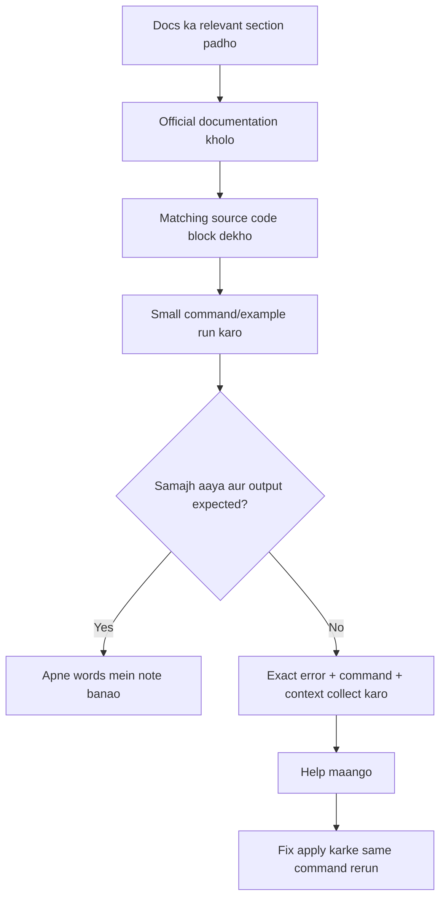

# 07 — Resources, Videos aur Help kaise leni hai

Is page ka purpose ye hai ki tumhe pata ho **kis topic ke liye kahan jaana hai**, har issue par random videos search nahi karni.

## 1. Learning workflow



## 2. Kis question ke liye kaunsa source?

| Question | First place to check |
|---|---|
| Python syntax/function/class nahi samajh aayi | [Python tutorial](https://docs.python.org/3/tutorial/) and [03 Python basics](03-python-basics.md) |
| Array, shape, indexing confusing hai | [NumPy quickstart](https://numpy.org/doc/stable/user/quickstart.html) |
| `reset()` / `step()` API question | [Gymnasium Env API](https://gymnasium.farama.org/api/env/) and [04 Maze environment](04-maze-environment.md) |
| PPO parameter ka meaning | [SB3 PPO documentation](https://stable-baselines3.readthedocs.io/en/master/modules/ppo.html) and [05 RL and PPO](05-reinforcement-learning.md) |
| Custom environment checker fails | [SB3 custom environments](https://stable-baselines3.readthedocs.io/en/master/guide/custom_env.html) |
| Install/version problem | [SB3 installation](https://stable-baselines3.readthedocs.io/en/master/guide/install.html) |
| Chart or plot issue | [Matplotlib quick start](https://matplotlib.org/stable/users/explain/quick_start.html) |
| Project code ka overall flow | [00 Project flow](00-project-flow.md) |
| Code block ka role samajhna | [08 Code walkthrough](08-code-walkthrough.md) |
| Project kisi ko explain karna | [09 How to explain project](09-how-to-explain-project.md) |

## 3. Official documentation vs YouTube

Official documentation ko API behavior aur correct parameters ke liye source of truth samjho. Video concept ko visually samajhne mein help karti hai, lekin video ki library version tumhare installed version se different ho sakti hai.

Recommended sequence:
1. Is repo ka relevant doc section.
2. Official documentation mein matching page.
3. Video sirf jab concept abhi bhi unclear ho.
4. Code run karke output verify.

## 4. Video links (topic-specific searches)

Ye YouTube search links hain, kisi single creator ki endorsement nahi. Search results mein beginner-friendly aur current-version tutorial choose karo.

- [Python functions/classes/objects](https://www.youtube.com/results?search_query=python+functions+classes+objects+beginner+tutorial)
- [NumPy arrays, shape and flatten](https://www.youtube.com/results?search_query=numpy+arrays+shape+stack+flatten+beginner)
- [Gymnasium custom environment](https://www.youtube.com/results?search_query=Gymnasium+custom+environment+Stable+Baselines3+tutorial)
- [Reinforcement Learning basics](https://www.youtube.com/results?search_query=reinforcement+learning+agent+environment+reward+beginner)
- [PPO explained](https://www.youtube.com/results?search_query=PPO+reinforcement+learning+explained+beginner)
- [Stable-Baselines3 PPO tutorial](https://www.youtube.com/results?search_query=Stable+Baselines3+PPO+Gymnasium+tutorial)
- [Matplotlib charts](https://www.youtube.com/results?search_query=matplotlib+bar+chart+beginner+tutorial)
- [PyCharm interpreter and virtualenv](https://www.youtube.com/results?search_query=PyCharm+Python+interpreter+virtualenv+Windows)

## 5. Help maangte waqt kya bhejna hai?

Sirf "code nahi chal raha" likhne se exact issue identify karna mushkil hota hai. Ye information bhejo:

```text
Project: MazeMind
File/step: (e.g. installing requirements / environment checker / train.py)
Command I ran:
[exact command]

Full error/traceback:
[copy from terminal, last line only nahi]

Python version:
[python --version output]

Interpreter:
[PyCharm selected interpreter / venv info]

What I expected:
[expected output]

What happened:
[actual output]
```

Screenshot useful hai, lekin error text copy kar sakte ho to aur achha. API keys/passwords kabhi share mat karna; is project mein API key required nahi.

## 6. Debugging ka safe method

1. Error ki last line padho; uske upar ka traceback bhi dekho.
2. Identify karo error installation, import, environment, training, evaluation ya visualization stage mein hai.
3. Ek time par ek change karo.
4. Same command dobara run karo.
5. Output record karo.
6. Error fix hone par next stage par jao.

Har error par saari files rewrite mat karo. Error ka source samajhkar minimum relevant change karo.

## 7. Official reference list

- [Python tutorial](https://docs.python.org/3/tutorial/)
- [NumPy quickstart](https://numpy.org/doc/stable/user/quickstart.html)
- [Gymnasium environment creation](https://gymnasium.farama.org/tutorials/gymnasium_basics/environment_creation/)
- [Gymnasium Env API](https://gymnasium.farama.org/api/env/)
- [SB3 installation](https://stable-baselines3.readthedocs.io/en/master/guide/install.html)
- [SB3 PPO](https://stable-baselines3.readthedocs.io/en/master/modules/ppo.html)
- [SB3 custom environments](https://stable-baselines3.readthedocs.io/en/master/guide/custom_env.html)
- [Matplotlib quick start](https://matplotlib.org/stable/users/explain/quick_start.html)
- [Hugging Face Deep RL course](https://huggingface.co/learn/deep-rl-course/unit0/introduction)

## 8. Project mein help kahan se leni hai?

Agar concept unclear ho to matching docs padho aur specific question poochho. Agar command fail ho to exact traceback bhejo. Agar tum kisi concept ko step-by-step seekhna chahte ho, ek hi concept par focus karo; next concept tab jab current example samajh aa jaye.
