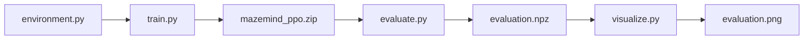

# 08 — Code Walkthrough: Files ko ek saath samjho

Is guide ko PyCharm mein source files kholkar follow karo. Code snippets important blocks ke excerpts hain; full source of truth GitHub ki Python files hain. Snippets ko poori file ke replacement ke roop mein copy mat karna.

## Source code kahan milega?

- [environment.py](../environment.py) — maze and rules.
- [train.py](../train.py) — PPO training.
- [evaluate.py](../evaluate.py) — comparison and metrics.
- [visualize.py](../visualize.py) — plots.
- [requirements.txt](../requirements.txt) — dependencies.

## Overall code flow



## 1. environment.py

### Imports

```python
import gymnasium as gym
import numpy as np
from gymnasium import spaces
```

Gymnasium standard environment interface deta hai. NumPy arrays aur numeric operations ke liye hai. `spaces` define karta hai ki actions aur observations ka format kya hai.

### Environment class

```python
class MazeEnv(gym.Env):
    def __init__(self, max_steps=50):
        super().__init__()
        self.rows = 5
        self.cols = 5
        self.max_steps = max_steps
```

Class environment ka blueprint hai. `__init__` initial settings assign karta hai. `self` current environment object ko refer karta hai. `super().__init__()` parent Gymnasium class ka initialization call karta hai.

### State fields and maze

`self.walls` ek 5×5 array hai. `self.start=(0,0)` aur `self.goal=(4,4)`. `self.agent` current coordinate track karta hai. `self.steps` current episode mein kitne moves attempt hue, ye count karta hai.

### Observation creation

```python
agent_layer = np.zeros_like(self.walls)
agent_layer[self.agent] = 1.0
stacked = np.stack([self.walls, self.goal_layer, agent_layer])
return stacked.flatten().astype(np.float32)
```

1. Agent ke liye blank 5×5 layer banao.
2. Current cell par 1 rakho.
3. Walls, goal aur agent layers stack karo.
4. 75 values mein flatten karo.
5. `float32` type ensure karo.

Why 75? `3 × 5 × 5 = 75`. Flat vector PPO ki MLP policy ke input ke liye hai.

### reset()

`reset()` agent ko start cell par rakhta hai, steps ko zero karta hai, aur initial observation ke saath empty info dictionary return karta hai. Har episode ki fresh start state milti hai.

### step(action)

Ye environment ka central function hai. Action number movement dictionary se delta leta hai; candidate coordinate calculate karta hai; bounds aur wall check karta hai; valid hone par move karta hai; reward assign karta hai; phir next observation, reward, terminated, truncated aur info return karta hai.

Gymnasium ke five return values:

| Value | Meaning |
|---|---|
| `observation` | Action ke baad environment ki current numeric information |
| `reward` | Is step ka score/feedback |
| `terminated` | Goal achieve hone se task end hua? |
| `truncated` | Step limit ki wajah se episode end hua? |
| `info` | Additional diagnostic info; is project mein empty dictionary |

### render()

Text maze display banata hai: A agent, G goal, # wall, . free cell. PPO text rendering read nahi karta; PPO numeric observation leta hai.

## 2. train.py

### Imports and paths

```python
from pathlib import Path
from stable_baselines3 import PPO
from stable_baselines3.common.env_checker import check_env
from stable_baselines3.common.monitor import Monitor
from environment import MazeEnv
```

- `Path`: file paths construct karta hai.
- `PPO`: ready-made algorithm.
- `check_env`: environment API validate karta hai.
- `Monitor`: episode statistics log karta hai.
- `MazeEnv`: hamara custom environment.

```python
OUTPUT_DIR = Path("outputs")
MODEL_PATH = OUTPUT_DIR / "mazemind_ppo"
```

Output directory aur model save path define hote hain. Stable-Baselines3 file ko `mazemind_ppo.zip` ke roop mein save karta hai.

### Environment validation and monitoring

```python
OUTPUT_DIR.mkdir(exist_ok=True)
check_env(MazeEnv())
env = Monitor(MazeEnv(), filename=str(OUTPUT_DIR / "training_monitor.csv"))
```

- Folder missing ho to create karo.
- Environment checker run karo.
- Monitor wrapper se episode statistics CSV mein record karo.

### PPO configuration

```python
model = PPO(
    "MlpPolicy", env,
    learning_rate=0.0003,
    n_steps=256,
    batch_size=64,
    gamma=0.99,
    verbose=1,
    seed=42,
)
```

`MlpPolicy` flat 75-value observation ko fully connected neural network se process karti hai. Learning rate update size, n_steps collected experience, batch size minibatch size, gamma future rewards ka discount, verbose logs, aur seed randomness control mein help karta hai. Ye parameters starting settings hain, guaranteed optimal nahi.

### Train and save

```python
model.learn(total_timesteps=20_000)
model.save(str(MODEL_PATH))
```

PPO 20,000 environment timesteps tak experience collect/update karta hai. Phir trained policy save hoti hai. Model file create hona success rate high hone ka proof nahi; evaluation next step hai.

## 3. evaluate.py

### Model load

```python
model = PPO.load(str(MODEL_PATH))
```

Previously saved policy ko load karta hai. Model path missing ho to script clear error deti hai; pehle training complete karo.

### Random vs PPO action

Random baseline:

```python
action = env.action_space.sample()
```

Randomly one valid action select karta hai.

PPO:

```python
action, _ = model.predict(observation, deterministic=True)
```

Trained model current observation se action predict karta hai. `deterministic=True` evaluation ke liye deterministic prediction request karta hai. `_` second return value ko ignore karne ka common Python convention hai.

### Episode loop

Har episode reset se start hota hai. Har action ke baad reward add hota hai. Goal reach ho ya max steps use ho jaayein to episode end hota hai. Script success flag, steps aur total reward record karti hai.

### Metrics

```python
success_rate = np.mean([item["success"] for item in results])
mean_steps = np.mean([item["steps"] for item in results])
mean_reward = np.mean([item["reward"] for item in results])
```

Success values 0/1 hoti hain, isliye unka mean success fraction hota hai. Example: 18 successes / 30 episodes = 0.6 = 60%. Mean steps aur mean reward average values hain.

`np.savez` random aur PPO episode-level arrays ko `evaluation.npz` mein store karta hai, jise next script read karegi.

## 4. visualize.py

```python
data = np.load(RESULTS_PATH)
```

Evaluation output file read hoti hai. Agar file missing ho, pehle `evaluate.py` run karo.

```python
success_rates = [
    np.mean(data["random_success"]),
    np.mean(data["ppo_success"]),
]
```

Arrays ka mean nikalta hai. Matplotlib phir success rate aur mean steps ke bar charts draw karta hai. `fig.savefig(...)` image save karta hai; `plt.show()` display karne ki koshish karta hai.

## 5. requirements.txt

Is file mein dependencies listed hain, jaise Gymnasium, Stable-Baselines3, NumPy aur Matplotlib. `python -m pip install -r requirements.txt` in packages ko selected Python environment mein install karta hai. Package versions supported range ke andar resolve hote hain; install issue aaye to Python version aur full error note karo.

## 6. Run commands in order

```bash
python -m pip install -r requirements.txt
python -c "from stable_baselines3.common.env_checker import check_env; from environment import MazeEnv; check_env(MazeEnv()); print('Environment OK')"
python train.py
python evaluate.py
python visualize.py
```

## 7. Common conceptual confusions

- **Environment is not the model:** environment world/rules define karta hai; PPO policy decisions learn karti hai.
- **Training is not evaluation:** training policy update karti hai; evaluation performance measure karti hai.
- **A chart is not the raw data:** `evaluation.npz` numeric results hai; `evaluation.png` visualization hai.
- **Random baseline is not another trained model:** woh random valid actions leta hai.
- **PPO maths is not hand-coded here:** Stable-Baselines3 implementation use hoti hai.

Official references: [Gymnasium Env API](https://gymnasium.farama.org/api/env/), [SB3 PPO](https://stable-baselines3.readthedocs.io/en/master/modules/ppo.html), [SB3 Monitor](https://stable-baselines3.readthedocs.io/en/master/common/monitor.html), [NumPy savez](https://numpy.org/doc/stable/reference/generated/numpy.savez.html), [Matplotlib quick start](https://matplotlib.org/stable/users/explain/quick_start.html).
