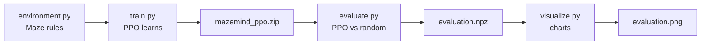
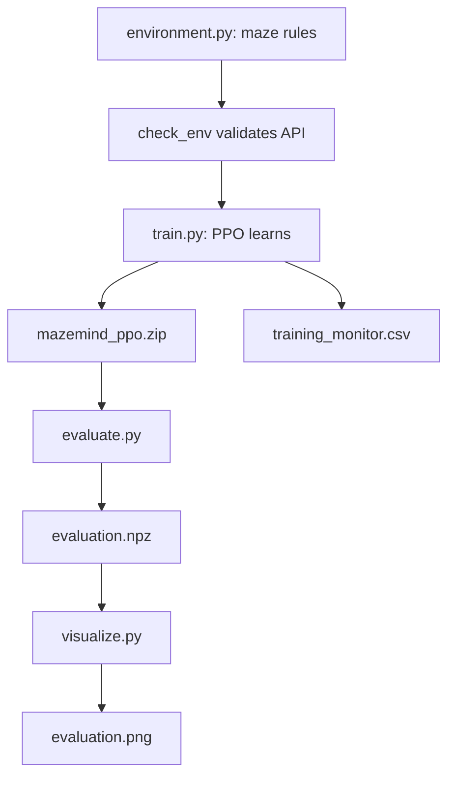

# 08 — Code Walkthrough: Understand the Main Files

This document explains the important lines and blocks in the actual MazeMind source code. Keep the matching Python file open in PyCharm while reading. The snippets below are shortened excerpts, not replacement files.

## Before the code: data flow



## 1. `environment.py` — define the world

### Imports

```python
import gymnasium as gym
import numpy as np
from gymnasium import spaces
```

- `gymnasium` provides the standard interface an RL algorithm expects.
- `numpy` stores the maze and creates numeric observations.
- `spaces` describes which actions and observations are valid.

### Class and settings

```python
class MazeEnv(gym.Env):
    def __init__(self, max_steps=50):
        super().__init__()
        self.rows = 5
        self.cols = 5
        self.max_steps = max_steps
```

- `class MazeEnv(gym.Env)`: defines our environment using Gymnasium's base interface.
- `__init__`: runs when `MazeEnv()` is created.
- `super().__init__()`: initializes the parent environment.
- `self.rows`, `self.cols`: dimensions of the grid.
- `self.max_steps`: maximum actions allowed in one attempt.

### Maze array

```python
self.walls = np.array([
    [0, 0, 1, 0, 0],
    [1, 0, 1, 0, 1],
    [0, 0, 0, 0, 0],
    [0, 1, 1, 1, 0],
    [1, 0, 0, 0, 0],
], dtype=np.float32)
```

Each nested list is one row. A 1 blocks movement; a 0 is walkable. `dtype=np.float32` stores numbers in the type expected by the observation space.

### Start, goal and action space

```python
self.start = (0, 0)
self.goal = (4, 4)
self.action_space = spaces.Discrete(4)
```

- A coordinate is `(row, column)`; Python indexes from zero.
- `Discrete(4)` means actions are integers 0, 1, 2 or 3.
- In this project: 0=up, 1=right, 2=down, 3=left.

The `moves` dictionary translates an action into a row/column change. For example, action 1 maps to `(0, 1)`, so the row stays the same and column increases by one.

### Observation space

```python
self.observation_space = spaces.Box(
    low=0.0, high=1.0,
    shape=(3 * self.rows * self.cols,),
    dtype=np.float32,
)
```

The observation is a vector of 75 values: 3 layers × 5 rows × 5 columns. `Box` declares the numeric range, shape and data type that the environment returns.

### `_get_obs()`: convert the world into numbers

```python
agent_layer = np.zeros_like(self.walls)
agent_layer[self.agent] = 1.0
stacked = np.stack([self.walls, self.goal_layer, agent_layer])
return stacked.flatten().astype(np.float32)
```

1. Create a zero-filled 5×5 layer for the agent.
2. Put a 1 at the agent's current coordinate.
3. Stack wall, goal and agent layers into shape `(3, 5, 5)`.
4. Flatten the layers into 75 values and ensure the type is `float32`.

### `reset()`: start an episode

```python
super().reset(seed=seed)
self.agent = self.start
self.steps = 0
return self._get_obs(), {}
```

Reset returns the agent to the start, clears the step counter and returns the initial observation plus an empty information dictionary. Gymnasium expects the pair `(observation, info)`.

### `step(action)`: apply one move

The real function does this sequence:
1. Find the movement delta for the chosen action.
2. Calculate the proposed next row and column.
3. Increase the step counter.
4. Give the ordinary step penalty `-0.01`.
5. Move only if the proposed cell is inside the grid and is not a wall.
6. If the agent reaches the goal, give reward `+1.0`.
7. Set `terminated=True` for goal reached.
8. Set `truncated=True` if the 50-step limit is reached without success.
9. Return the next observation, reward, both flags and info.

Gymnasium's required return shape is:

```python
observation, reward, terminated, truncated, info
```

An invalid move leaves the agent in the same cell but still consumes a step.

### `render()`

This function creates a readable text view: A=agent, G=goal, #=wall and .=free cell. It is only a debugging display; PPO learns from the numeric observation, not from the letters in the printed maze.

## 2. `train.py` — train and save PPO

### Paths

```python
OUTPUT_DIR = Path("outputs")
MODEL_PATH = OUTPUT_DIR / "mazemind_ppo"
```

`Path` builds file paths in a platform-friendly way. The model is saved as `outputs/mazemind_ppo.zip` by Stable-Baselines3.

### Validate and wrap the environment

```python
OUTPUT_DIR.mkdir(exist_ok=True)
check_env(MazeEnv())
env = Monitor(MazeEnv(), filename=str(OUTPUT_DIR / "training_monitor.csv"))
```

- `mkdir(exist_ok=True)` creates the output folder if needed.
- `check_env` checks common Gymnasium API mistakes.
- `Monitor` records episode statistics in a CSV file.

### Create the PPO model

```python
model = PPO(
    "MlpPolicy", env,
    learning_rate=0.0003,
    n_steps=256,
    batch_size=64,
    gamma=0.99,
    verbose=1,
    seed=42,
)
```

- `PPO`: algorithm implementation from Stable-Baselines3.
- `MlpPolicy`: a fully connected neural network policy for the flat observation vector.
- `learning_rate`: optimizer update size.
- `n_steps`: environment steps collected before a training update.
- `batch_size`: samples processed in a minibatch.
- `gamma`: discount factor for future rewards.
- `verbose=1`: show training logs.
- `seed=42`: helps make the run repeatable; it does not guarantee identical results on every machine.

### Learn and save

```python
model.learn(total_timesteps=20_000)
model.save(str(MODEL_PATH))
```

PPO interacts with the environment for a budget of 20,000 timesteps, updates its policy, and saves the model. A timestep is one call to the environment's `step()` during training. A saved file does not prove that the policy performs well; evaluation checks that.

## 3. `evaluate.py` — compare PPO with random actions

### One episode

```python
observation, _ = env.reset()
action = env.action_space.sample()
observation, reward, terminated, truncated, _ = env.step(action)
```

- `reset()` starts a fresh attempt.
- `action_space.sample()` selects a random valid action.
- `step(action)` applies it and returns the next state and feedback.
- The loop stops when the goal is reached or the step limit is hit.

When a PPO model is supplied, the action instead comes from:

```python
action, _ = model.predict(observation, deterministic=True)
```

`deterministic=True` asks PPO to choose its deterministic prediction for evaluation. The second returned value is unused here, so it is stored in `_`.

### Metrics

- **Success rate:** number of successful episodes divided by number of episodes. For example, 15 successes out of 30 means 50%.
- **Mean steps:** average number of actions per episode. Read this alongside success rate; failing quickly is not a good result.
- **Mean reward:** average sum of rewards collected in an episode.

The script runs 30 random episodes and 30 PPO episodes. It saves the episode-level success and step arrays in `outputs/evaluation.npz`. Terminal metrics will vary; copy your actual output into any report.

## 4. `visualize.py` — make charts

```python
data = np.load(RESULTS_PATH)
success_rates = [
    np.mean(data["random_success"]),
    np.mean(data["ppo_success"]),
]
```

- `np.load` reads the saved evaluation arrays.
- `np.mean` calculates the average; for arrays of zeros and ones, the mean is the success fraction.
- Matplotlib draws two bar charts: success rate and mean steps.
- `fig.savefig(...)` saves the figure as `outputs/evaluation.png`.
- `plt.show()` opens the chart window.

This script needs `evaluation.npz`, so run `evaluate.py` first.

## 5. Full execution order



## 6. Commands and expected files

Run from the repository root:

```bash
python -m pip install -r requirements.txt
python -c "from stable_baselines3.common.env_checker import check_env; from environment import MazeEnv; check_env(MazeEnv()); print('Environment OK')"
python train.py
python evaluate.py
python visualize.py
```

Expected artifacts after each stage:

| Stage | Expected artifact or message |
|---|---|
| Environment check | `Environment OK` |
| Training | `outputs/mazemind_ppo.zip` and `outputs/training_monitor.csv` |
| Evaluation | Metrics in terminal and `outputs/evaluation.npz` |
| Visualization | `outputs/evaluation.png` |

These are expected paths, not guaranteed metrics. If a command raises an error, fix it before proceeding.

## References and videos

- [Gymnasium environment API](https://gymnasium.farama.org/api/env/)
- [Stable-Baselines3 PPO](https://stable-baselines3.readthedocs.io/en/master/modules/ppo.html)
- [SB3 Monitor](https://stable-baselines3.readthedocs.io/en/master/common/monitor.html)
- [NumPy savez](https://numpy.org/doc/stable/reference/generated/numpy.savez.html)
- [Matplotlib quick start](https://matplotlib.org/stable/users/explain/quick_start.html)
- Video searches: [Python classes and functions](https://www.youtube.com/results?search_query=python+classes+functions+beginner+tutorial), [PPO explained](https://www.youtube.com/results?search_query=PPO+reinforcement+learning+explained+beginner), [Matplotlib bar charts](https://www.youtube.com/results?search_query=matplotlib+bar+chart+beginner+tutorial).

## Self-check

Before moving on, try to explain:
1. Why does the environment return five values from `step()`?
2. Why does the observation contain 75 numbers?
3. What is the difference between `train.py` and `evaluate.py`?
4. Why do we need `evaluation.npz` before plotting?
5. Why is a success rate more meaningful than merely checking whether the model file exists?
