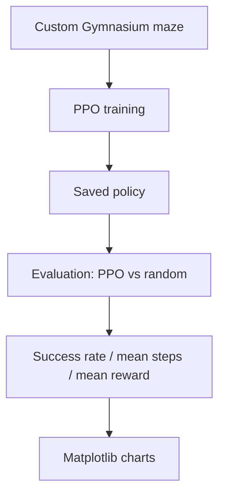

# 09 — Project ko samajhna aur kisi aur ko explain karna

Is page ko project ka oral explanation / demo preparation guide samjho. Script ko word-for-word ratta mat maaro. Har answer ka meaning samjho aur apne words mein bolo.

## 1. 30-second explanation

“MazeMind ek beginner-friendly Reinforcement Learning project hai. Ismein hum Gymnasium ke through ek fixed 5×5 maze environment banate hain. Agent ko up, right, down aur left actions milte hain. Stable-Baselines3 ki PPO algorithm agent ko train karne ke liye use hoti hai. Training ke baad hum PPO ko random-action baseline se compare karte hain, success rate aur average steps measure karte hain, aur Matplotlib se results visualize karte hain. Project ka focus RL ka end-to-end workflow samajhna hai, production app banana nahi.”

## 2. Architecture explain kaise karein?



- **Environment:** maze aur its rules.
- **Training:** policy experience se improve karne ki koshish karti hai.
- **Evaluation:** independent episodes mein behavior measure hota hai.
- **Visualization:** metrics ko charts mein compare karte hain.

## 3. Common questions and clear answers

### Q1. Project ka objective kya hai?
RL workflow practically samajhna: environment design, reward/action/observation define karna, PPO train karna, baseline se compare karna aur metrics plot karna.

### Q2. Reinforcement Learning kya hai?
Machine learning ka approach jahan agent environment mein actions leta hai aur rewards receive karta hai. Agent long-term reward improve karne wali policy seekhne ki koshish karta hai.

### Q3. PPO kyun use kiya?
PPO ek popular policy-gradient RL algorithm hai aur Stable-Baselines3 mein ready implementation available hai. Isse hum algorithm ko scratch se implement kiye bina environment aur experiment workflow par focus kar sakte hain.

### Q4. Gymnasium kya karta hai?
Gymnasium environment ka standard API deta hai—action space, observation space, reset aur step. Ye RL library aur hamare custom maze ke beech consistent interface banata hai.

### Q5. Agent ko input kya milta hai?
3 numeric layers—walls, goal, current agent position—ko stack aur flatten karke 75-value vector diya jaata hai.

### Q6. Actions kitne hain?
4 discrete actions: 0 up, 1 right, 2 down, 3 left.

### Q7. Reward kaise define kiya?
Normal step par -0.01 aur goal par +1.0. Small step penalty wandering ko discourage karne ka attempt hai; goal reward task completion signal karta hai.

### Q8. Terminated aur truncated mein difference?
`terminated` means goal achieve ho gaya. `truncated` means episode step limit tak pahunch gaya without goal.

### Q9. Random baseline kyun?
Random agent reference point deta hai. PPO ki performance ko random behavior ke against compare karne se pata chalta hai ki trained policy is experiment mein better perform kar rahi hai ya nahi.

### Q10. Kaunse metrics hain?
Success rate, mean steps aur mean reward. Success rate goal tak pahunchne wale episodes ka fraction hai. Mean steps average episode length hai. Mean reward average episode reward total hai.

### Q11. Kya project guaranteed maze solve karta hai?
Nahi. Training settings starting values hain; success guaranteed nahi. Actual evaluation numbers report karne chahiye.

### Q12. PPO algorithm ka code tumne likha?
Nahi. Stable-Baselines3 ki PPO implementation use ki. Hamara custom code environment, training configuration, evaluation aur visualization handle karta hai.

### Q13. Main limitations?
One fixed maze; unseen mazes par generalization test nahi hoti; small training budget; random baseline kabhi-kabhi success kar sakta hai; ek run se strong research conclusion nahi nikalta.

### Q14. Ismein kaunsi maths hai?
Grid indexing, arrays and shapes, rewards, reward sum/discounted return, mean and success-rate calculation. PPO optimization ka internal math library handle karti hai.

## 4. Maths ko simple example se explain karo

### Observation size
3 layers × 5 rows × 5 columns = 75 numbers.

### Success rate
Agar 30 evaluation episodes mein 18 goal tak pahunchte hain:

```text
success rate = 18 / 30 = 0.60 = 60%
```

### Example return
3 ordinary steps aur phir goal reward:

```text
-0.01 + -0.01 + -0.01 + 1.0 = 0.97
```

Ye illustrative calculation hai, actual project run ka result nahi.

### Discounted return
Future rewards ko `gamma` se discount kiya ja sakta hai. Is project mein gamma 0.99 hai. PPO internally advantage/return related calculations karta hai; hum unko manually implement nahi karte.

## 5. Demo ke liye recommended order

1. README aur project flowchart show karo.
2. `environment.py` mein maze, actions, observation aur reward explain karo.
3. Environment checker run karke `Environment OK` show karo.
4. `train.py` mein PPO settings aur model save line explain karo.
5. Training complete hone par saved model file show karo.
6. `evaluate.py` run karke actual random vs PPO metrics show karo.
7. `visualize.py` run karke chart show karo.
8. Limitations aur real measured results honestly discuss karo.

Agar training abhi run nahi hui, demo mein result fabricate mat karo. Clearly bolo ki setup/code prepared hai but experiment result pending hai.

## 6. Kya improve ho sakta hai? (Future work, not current scope)

- Multiple random maze layouts par evaluation.
- Multiple seeds se repeated runs.
- Better visual rendering.
- More systematic hyperparameter comparison.

Ye future work ideas hain; abhi implement karne ki zaroorat nahi. Pehle current project run karo aur code samjho.

## 7. Before explaining, ensure you can answer

- Environment aur PPO model ka difference?
- Observation mein 75 values kyun?
- Reward values kya hain aur kyun?
- Training, evaluation aur visualization alag scripts kyun?
- Model file, evaluation data aur chart ka difference?
- PPO random baseline se better tha? Tumhare actual metrics kya kehte hain?
- Project ki limitations kya hain?

Agar kisi question ka answer nahi aata, matching docs par wapas jao. [00 Project Flow](00-project-flow.md), [04 Environment](04-maze-environment.md), [05 RL/PPO](05-reinforcement-learning.md), [06 Evaluation](06-training-and-evaluation.md) aur [08 Code Walkthrough](08-code-walkthrough.md) main references hain.
